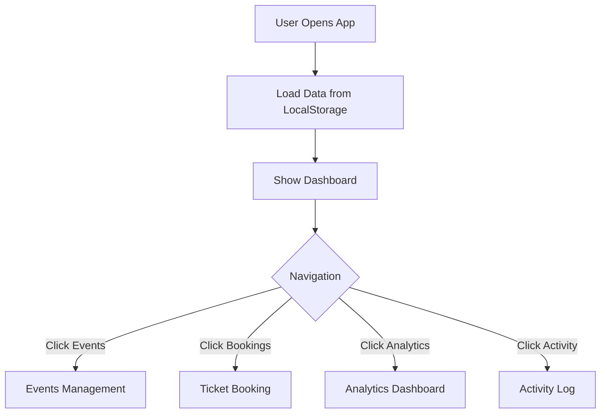
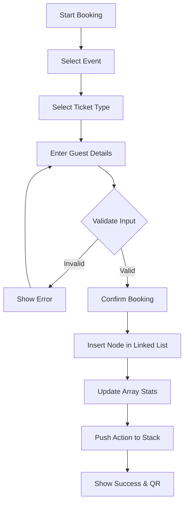
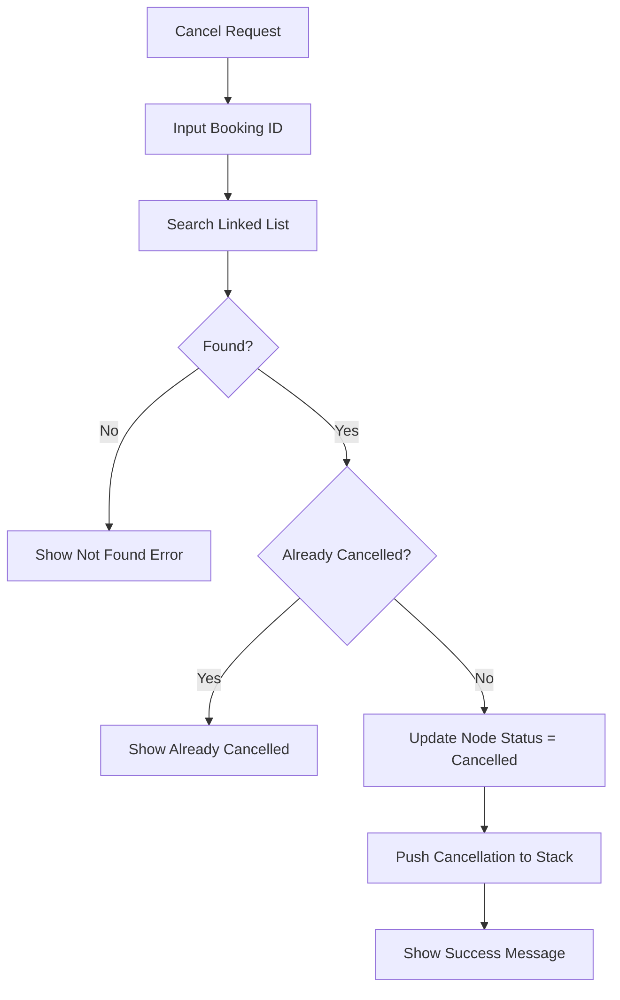
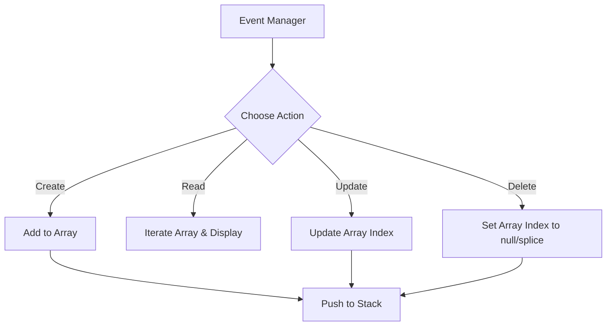

# Flowcharts

## 1. Overall System Flow


## 2. Ticket Booking Flow


## 3. Ticket Cancellation Flow


## 4. Linked List Insertion (At Head)
```mermaid
flowchart TD
    Start[Create New Node] --> Create[Node(Data, Next=null)]
    Create --> CheckHead{Is Head Null?}
    CheckHead -->|Yes| SetHead[Head = New Node]
    CheckHead -->|No| PointNext[New Node.Next = Head]
    PointNext --> UpdateHead[Head = New Node]
    SetHead --> End[Done]
    UpdateHead --> End
```

## 5. Linked List Search
```mermaid
flowchart TD
    Start[Search(ID)] --> Init[Current = Head]
    Init --> LoopCheck{Current != null?}
    LoopCheck -->|No| ReturnNull[Return Null / Not Found]
    LoopCheck -->|Yes| MatchCheck{Current.Data.ID == ID?}
    MatchCheck -->|Yes| ReturnFound[Return Current.Data]
    MatchCheck -->|No| MoveNext[Current = Current.Next]
    MoveNext --> LoopCheck
```

## 6. Linked List Logical Deletion
```mermaid
flowchart TD
    Start[Delete(ID)] --> Find[Search Linked List for ID]
    Find --> FoundCheck{Node Found?}
    FoundCheck -->|No| EndErr[Return Error]
    FoundCheck -->|Yes| Update[Set Node.Data.Status = 'Cancelled']
    Update --> End[Done]
```

## 7. Stack Push Operation
```mermaid
flowchart TD
    Start[Push(Action)] --> CheckFull{Is Array Full?}
    CheckFull -->|Yes| Error[Stack Overflow Exception]
    CheckFull -->|No| Insert[Array[Top] = Action]
    Insert --> Inc[Top = Top + 1]
    Inc --> End[Done]
```

## 8. Stack Pop Operation (Undo)
```mermaid
flowchart TD
    Start[Pop()] --> CheckEmpty{Is Array Empty?}
    CheckEmpty -->|Yes| Error[Stack Underflow Exception]
    CheckEmpty -->|No| Dec[Top = Top - 1]
    Dec --> GetItem[Item = Array[Top]]
    GetItem --> Return[Return Item]
    Return --> ReverseAction[Execute Reverse Logic]
```

## 9. Event CRUD Flow

